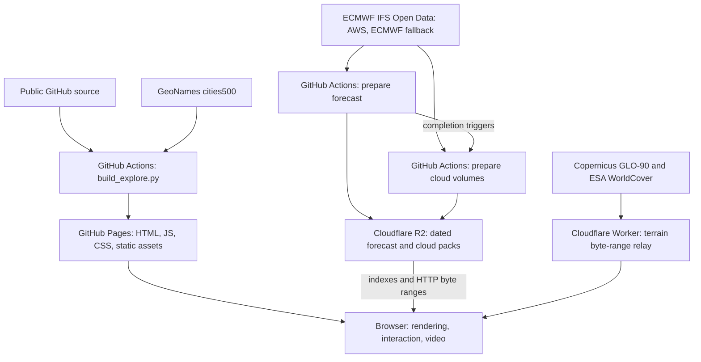

# Weather Explorer: web viewer

A public browser viewer with three tabs: **Highlights**, **Past events** and **Explore**:
**https://weatherexplorer.neilgordon.me/** (the original https://tehoro.github.io/weather-explorer-web/ redirects here)

Weather Explorer is a prototype for exploring animated ECMWF weather forecasts. Once a day an AI
research agent picks about fifteen interesting weather situations around the world and describes
how to show them; this viewer animates them on an interactive map, with a 3D view for tropical
cyclones. Past events replay selected historical weather. **[Explore](https://weatherexplorer.neilgordon.me/explore/)** lets you choose a place anywhere on the globe and explore the current IFS forecast over detailed 3D terrain, independently of the highlights. The highlights research runs in the backend: https://github.com/tehoro/weather-explorer-backend

> **Please read [Important caveats](#important-caveats) before using anything here.** This is a
> prototype. It is not an ECMWF service. Weather is model guidance, highlights are chosen and
> written by an AI model, and its code was written with AI coding tools.

## Who made this, and how

The original code and documentation in this repository were written by **Claude Opus 5.5**, an AI
model made by [Anthropic](https://www.anthropic.com), working in
[Claude Code](https://claude.com/claude-code) at the direction of **Neil Gordon**. Neil set the
goals, the design rules and the priorities, tested the results and decided what to keep. Claude
wrote the code, ran the tests and wrote the commit messages.

Subsequent development also uses OpenAI Codex, including the November 2026 Explore viewer,
forecast/cloud preprocessing, terrain streaming and sync optimisation, directed and tested by Neil.

Neil developed Weather Explorer as an **ECMWF Visiting Scientist**. ECMWF supported
the work by providing the Claude Opus 5.5 usage, through its enterprise account, with which the
code was written. That support does not make it an ECMWF product or service (see below).

Two of Neil's rules shape the design: live forecasts use ECMWF's free **Open Data**, so anyone can
reproduce the forecast fields; and everything that scales with the number of viewers (decoding, colouring,
contours, particles, the 3D view) runs **in the browser**, so the site is static files on GitHub
Pages with no server calculating weather per viewer. Explore adds shared R2 data storage and a
bounded terrain-file relay, described below.

## Important caveats

**Not an official forecast or warning.** Everything shown is model guidance from ECMWF's
forecasts. Highlights are chosen and described by an AI model; Explore displays prepared IFS fields
using fixed algorithms, without an AI model generating each scene. It can be wrong, out of date or misleading. For
forecasts and warnings, use your national weather service. Nobody should rely on this for safety,
travel, operations or any decision.

**Not an ECMWF service.** It uses ECMWF's free Open Data and was developed with ECMWF's support
(see above), but it is not an official or operational ECMWF product or service. ECMWF does not
run it, maintain it or vouch for its content.

**AI-chosen and AI-written content.** The highlights, captions and citations are written by an AI
model, checked automatically for structure but not reviewed by a person before publication.
Visuals are simplified: in the 3D view, clouds are *inferred from humidity*, heights are
*exaggerated*, and wind particles are sped up thousands of times.

**AI-written code.** The code was written by an AI model and tested in use, not audited line by
line. It is a working prototype, not production software, and may contain bugs. There is **no
warranty** (see the [licence](LICENSE)) and no support.

**Privacy.** The site counts visits with [GoatCounter](https://www.goatcounter.com), which uses no
cookies and collects no personal data. Units and time-zone choices are kept in your own browser.

## A reading guide to the code

The browser uses plain JavaScript, HTML and CSS without a framework or JavaScript bundler.
Explore has a Python packaging step (`build_explore.py`) that copies its source modules, configures
public data endpoints and fingerprints imports for cache invalidation. Start with:

- [**Explore architecture and operation**](#explore-worldwide-3d-forecasts): source files, preprocessing, terrain and clouds.
- [**Code map**](docs/code-map.md): every file, and `app.js` section by section, with experiments
  to try.
- [**One highlight, end to end**](https://github.com/tehoro/weather-explorer-backend/blob/main/docs/walkthrough.md):
  a real highlight followed from the forecast files, through the AI research and the backend, to
  the shader that colours each pixel.
- [**Glossary**](https://github.com/tehoro/weather-explorer-backend/blob/main/docs/glossary.md) and
  [**design decisions**](https://github.com/tehoro/weather-explorer-backend/blob/main/docs/design-decisions.md)
  (in the backend repository, shared by both).

The main files:

| Read | To see |
|---|---|
| `site/app.js` | The map: an equal-area (Lambert azimuthal) projection centred on the view, a WebGL2 shader that inverts the projection per pixel to colour the weather field, wind particles, the timeline, Share, Save and Video. |
| `site/worker.js` | A Web Worker that decodes frames and traces isobars (marching squares) and highs and lows off the main thread. |
| `site/units.js` | Units and time zones: converting measurements inside text, choosing defaults from the browser's time zone. |
| `site/3d/app3d.js` | three.js: ray-marched cloud volume, a sea shader with isobars, particle ribbons, storm-relative blending of frames. |
| `local-trial/` | The production Explore source modules; the directory name survives from its prototype. `build_explore.py` packages them into generated `site/explore/`. |
| `tools/refresh_explore_r2.py`, `tools/prepare_clouds_r2.py` | Shared global forecast and cloud preparation, validation and R2 publication. |
| `cloudflare/terrain-relay.mjs` | Bounded byte-range relay for public terrain and land-cover files. |
| `sync.py` | Turning the backend's JSON scenes into small lossless WebP images, 8 bits per value. |
| `build3d.py` | Fetching about 1,500 pieces of GRIB2 files from Open Data with HTTP Range requests and packing them into a 3D bundle. |
| `buildglobe.py` | The forecast cloud on the globe of highlights: one global field per frame, turned into a small greyscale image. |

The rest of this README describes each part in detail.

## How it fits together

The highlights pipeline uses the existing backend; Explore has its own shared preprocessing pipeline (below). A scheduled GitHub
Action reads the backend's existing endpoints with the app key, as one more app would, converts
the scene data into small static files, and publishes them with the viewer to GitHub Pages. Viewer
traffic goes to GitHub's CDN; the backend sees one download of each scene per sweep.

```
backend (Replit) ──/api/highlights, /api/requests, /scenes──▶ sync.py (GitHub Actions, after each sweep)
                                                                │ WebP frames + feed.json
                                                                ▼
                                                     GitHub Pages ──▶ browsers
```

## Pieces

- `sync.py` — fetches the feed, requested events and scene files; writes `site/data/`. Scene files
  never change once built, so each is converted once (kept in the Actions cache). Exit 3 means
  nothing new, and the workflow then skips deploying.
  Lossless WebP uses encoder effort 4: identical pixels with much faster encoding than effort 6,
  at a small increase in file size. New packages log their build time.
- `site/` — the viewer: `index.html` (including the Help text), `style.css`, `app.js` (equal-area map projection centred on the view,
  WebGL2 colour fill, pan/zoom, timeline, wind particles, panels), `worker.js` (frame decoding, isobars, highs and lows) and
  `basemap.json` (Natural Earth 1:50m land and borders, public domain).
- `tools/make_basemap.py` — rebuilds `basemap.json` from the world-atlas TopoJSON.
- `.github/workflows/deploy.yml` — sync and deploy, then the 3D jobs (see "3D view" below). Runs when the backend signals new highlights (`repository_dispatch`, see the backend's `web_notify.py`), with fallback checks at 22:30, 22:50 and 23:20 UTC, plus minute 5 every three hours; sync, cache and Pages deploy.

## Explore: worldwide 3D forecasts

Explore is the third public tab. Clicking it navigates to **`/explore/`**, which starts on a
spinning globe; selecting a place flies into the regional landscape. The inner landscape page
is `explore/global-test.html` (a retained filename, not a separate private service). Both routes
are packaged and deployed by the main Pages workflow.

### What the viewer adds

- Global place/coordinate search, place labels and forecast temperatures, point forecasts and
  clickable meteograms. The readout distinguishes terrain height from IFS model-grid height.
- Rotating, tilting and panning over detailed terrain; near-ground movement down to about 10 m
  above the displayed ground. The Near-ground preset raises the eye to clear nearby terrain.
  Orbit and forecast playback are independent controls.
- Animated wind trails, rain/snow, isobars, surface weather colours, lying snow and sea ice.
  Fine terrain does **not** downscale the model's wind, temperature or precipitation.
- Humidity-guided cloud volumes with liquid/ice optical thickness, opacity adjustment and
  terrain intersection. One View slider exaggerates both terrain and cloud heights, 1.0–2.0×.
- Share links containing the camera, time and settings; Clean view; live recording and smooth
  frame-by-frame 1080p video export. Video uses full-quality cloud rendering.

The help dialog in the landscape view explains the current controls. Explore streams public
files and needs a network connection; the single-file offline Save described below belongs to
the highlights viewer, not Explore.

### Data and deployment architecture



The application is served from `weatherexplorer.neilgordon.me`; forecast data are served from
`weatherdata.neilgordon.me/global-data/`. GitHub Actions does the shared work once for a new run.
The browser performs view-dependent sampling, interpolation and rendering. The terrain Worker
only relays allowed public files and bounded ranges; it does not calculate forecasts. Neither
Explore updates nor serving users depends on the developer's laptop or the highlights backend.

**Forecast preparation.** `explore-data.yml` requests a check twice hourly (UTC minutes 11 and 41),
after the main-branch site sync, or on manual dispatch. `auto_refresh.py` searches recent IFS
cycles for a newer complete 0.1° run, checking required fields at every three-hour step through
+84 h. It fetches selected GRIB messages using their indexes and HTTP ranges, using AWS first
and ECMWF as fallback. Python prepares fine/coarse weather tiles, a global preview, pressure,
precipitation type, point fields, place temperatures and snow/ice display fields. This is a
28-time forecast, +3 to +84 h; it does not expose the full IFS forecast length.

Validated gzip tiles are concatenated into `tiles.bin` files with `tiles.json` byte-offset
indexes. Only after upload succeeds does `latest.json` advance. Current and previous complete
runs are retained; failed preparation leaves the last usable forecast published. Browser workers
fetch the required ranges, and an open landscape stages a replacement run before switching.

**Cloud preparation.** `explore-clouds.yml` follows the forecast job and also requests an hourly
retry (UTC minute 26). Its run-specific manifest is published last, independently of the ordinary
forecast. A cloud failure therefore never blocks new weather. No paid AI inference is involved.
Schedules are requests to GitHub, not a punctuality guarantee: delayed or missing schedule events
have occurred. Check Actions history and the public manifests rather than treating an enabled
workflow as proof that it ran. See [R2 operations](docs/explore-r2.md) for recovery and configuration.

### How clouds work

IFS low/middle/high cloud fractions constrain the amount of cloud. Pressure-level humidity,
temperature and geopotential guide its vertical placement, with surface pressure and near-surface
fields helping define the lower boundary. Fixed rules fill vertically continuous layers rather
than drawing thin sheets at each pressure level. Stability and convective precipitation guide
illustrative irregular texture; they do not resolve individual cumulus clouds.

Total-column cloud liquid water (`tclw`) and ice water (`tciw`) are distributed within those
humidity-guided layers using temperature and cloud-support weights. They control display
extinction: ice-rich upper cloud can look thinner and softer than liquid-rich cloud. Optical
thickness is integrated along each viewing ray, with opacity based on `1 − exp(−optical thickness)`.
The coefficients and lighting are illustrative, not a calibrated radiation calculation or a
retrieved vertical condensate profile.

Preprocessed volumes have 128 height nodes over 0–20 km above sea level and three horizontal
resolutions (0.5°, 1° and 2°), packed per forecast time and resolution. The browser requests the
visible tiles around the two bracketing times, blends them and adds procedural detail appropriate
to viewing distance. Cloud rays stop at the displayed terrain, so cloud bases can intersect
mountains. The opacity slider remains effective; clouds appear more opaque from below, and zero
hides them. Wind-driven texture drift is disabled.

If matching volumes are unavailable, the viewer uses continuous, thicker low/middle/high volumes
from the ordinary IFS fractions. Their depths are schematic, not predicted cloud bases or tops.
The status below **Cloud opacity** identifies **humidity-guided clouds · liquid/ice optical
thickness** or **standard cloud layers**. It retries missing detailed data automatically.
The opening globe uses its separate broad-scale cloud display, not these regional volumes.

Live clouds use half-resolution ray marching with depth-aware reconstruction; terrain stays at
full resolution and mountain edges receive additional cloud sampling. Video selects the
full-resolution ray marcher. Bounded caches, interval prefetching and reuse of the shared time
endpoint reduce memory and avoid flashes at three-hour boundaries. See the detailed
[cloud algorithm, formats and performance notes](docs/explore-clouds.md).

### Terrain, snow and level of detail

A coarse NOAA ETOPO1 landscape appears first. Copernicus GLO-90 elevation and ESA WorldCover
2021 land/water cover progressively refine it. Terrain detail is chosen using distance, projected
screen size, viewing angle and relief; distant oblique patches can be coarser while visible
mountain silhouettes retain detail. Workers prepare the grids, and browser disk/memory caches
reuse them. The loading percentage describes the current requested patches and may change with
the view; a short delay suppresses brief loading-label flashes.

Lying snow follows IFS snow evidence and an inferred elevation boundary mapped onto detailed
terrain. Regional fallback needs supporting model evidence. New Zealand has an illustrative
Southern Alps reference fallback, with local evidence taking priority and a latitude adjustment
for northern ranges. It is not a high-resolution snow-depth forecast. Sea ice also follows IFS
surface fields. See `local-trial/prepare_surface_cover.py` and `snow-cover-shader.mjs`.

### Finding and running the Explore code

| Source | Responsibility |
|---|---|
| `local-trial/index.html`, `globe.js` | Explore globe and transition to the landscape. |
| `local-trial/global-test.js`, `global-ui.mjs` | Landscape scene, controls, Help and credits. |
| `local-trial/terrain-index.mjs`, `terrain-stream.mjs`, `terrain-worker.mjs` | Terrain selection, streaming and preparation. |
| `local-trial/weather-data.mjs`, `weather-worker.mjs`, `weather-view.mjs`, `run-refresh.mjs` | Forecast downloads, worker decoding, display and staged run replacement. |
| `local-trial/cloud-volumes.mjs`, `cloud-terrain.mjs` | Cloud rendering and terrain depth. |
| `tools/clouds/`, `tools/prepare_clouds_r2.py` | Cloud reconstruction, tiling and publication. |
| `local-trial/auto_refresh.py`, `tools/refresh_explore_r2.py`, `tools/publish_explore_r2.py` | Complete-run discovery, weather preparation and atomic R2 publication. |
| `local-trial/video-recording.mjs`, `video-export.mjs` | Live recording and smooth video export. |
| `build_explore.py`, `.github/workflows/deploy.yml` | Static packaging and Pages deployment. |

Despite its historical name, **`local-trial/` contains the production Explore source**. Generated
`site/explore/` is gitignored and rebuilt in Actions; it is not missing public source. Large
forecast datasets live in R2 rather than Git. The directory also contains older experiments:
its historical notes do not describe every current live feature.

To build a static local preview from a clean checkout, without the highlights backend key:

```bash
uv run --frozen build_explore.py --relay https://weather-explorer-terrain.neilgordon.workers.dev
python3 -m http.server 8090 --directory site
# Open http://localhost:8090/explore/
```

Packaging downloads the public place catalogue and terrain tile index when missing. The viewer
uses public R2 forecasts and the terrain relay; the chosen local origin must be allowed by the
R2 CORS policy. Publishing a fork requires configuring its own endpoints, Worker and R2 credentials
as described in [the setup guide](docs/explore-r2.md). No credentials belong in browser files.

Representative checks (from the repository root):

```bash
node local-trial/test-cloud-handover.mjs
node local-trial/test-cloud-rendering.mjs
node local-trial/test-terrain-index.mjs
node local-trial/test-camera-ground.mjs
uv run --frozen --with boto3 python -m unittest discover -s tools -p 'test_prepare_clouds.py'
uv run --frozen python -m unittest discover -s tools/clouds -p 'test_*.py'
```

## Sharing and saving (highlights)

- **Share** copies (or, on phones and iPads, offers through the share sheet) a link to exactly what
  is on screen: `#h=<tag>/<id>&s=<scene>&t=<valid time>&map=<style>&v=<lon>,<lat>,<zoom>`. Units
  and the time zone are left out, so each person sees their own. Each highlight is kept in `data/items/` for 7 days
  after it was last listed, so links keep working after the next sweep; an older one opens with a
  note that it may be out of date, and an expired one opens the latest highlights.
- **Save** builds a single HTML file in the browser, from files already on the site: the viewer
  plus every frame of one highlight (a few MB) or all current highlights (tens of MB), embedded as
  base64. It plays with no connection, like a saved highlight in the app. Satellite imagery still
  needs a connection; the dark and light maps don't. `units.js` and `app.js` are plain scripts
  (not modules) so the saved copy can inline them.

- **Video** draws the current scene frame by frame at 30 fps (at the viewer's playback speed) with the
  title, time, key, caption and credit, and encodes an MP4 in the browser with WebCodecs and
  [mp4-muxer](https://github.com/Vanilagy/mp4-muxer) (loaded from jsDelivr only when used). Square,
  4:5 and 16:9. The button is hidden where the browser has no `VideoEncoder`, and in saved copies.

## 3D view (tropical cyclones)

Highlights tagged `tropical-cyclone` get a **3D** button. `site/3d/` is a three.js model of the
highlight's box that you can turn, tilt and zoom: clouds and the warm core ray-marched from
humidity and temperature on 12 pressure levels, wind particles at 925 hPa (inflow) and 200 hPa
(outflow), rain, and the sea coloured by 10 m wind with isobars. It opens at the moment the map was
showing, returns to the same map view, and makes its own MP4 (same encoder as the map's Video).

`build3d.py` fetches the fields straight from ECMWF Open Data for the highlights' own run, about
1,500 range requests per storm (6–15 minutes each on GitHub's runners), and writes
`data/3d/<item>-<run>/meta.json` and `bundle.bin.gz` (4–12 MB, unpacked in the browser). The item
gets `"view3d"`. The backend is not involved.

So the map update never waits for it, it runs as separate workflow jobs **after** the site is
deployed (`build3d`, then `deploy3d` if anything changed). `sync.py` only attaches bundles that
already exist. A new storm therefore shows its 3D button one deploy later than its map. A storm
whose build fails has no 3D button, and is retried after the next sync. Bundles are kept while
the item is listed and rebuilt only for a new run.

```bash
uv run build3d.py          # build missing bundles for site/data/feed.json; exit 0 = changed, 3 = nothing new
```

### Clouds on the globe

The site opens on a globe of today's highlights, with the forecast's clouds moving over it for the
next three days. They are outgoing longwave radiation (OLR) from IFS HRES 0.25°: the infrared
energy leaving the top of the atmosphere, low where cloud tops are cold and high, so it looks like
an infrared satellite image. Very cold ground (the Antarctic ice sheet) looks pale too.

`buildglobe.py` takes the newest 00 or 12 UTC run, fetches its accumulated `ttr` every 3 hours
(34 range requests, under a minute), averages each 3-hour mean to 0.5° and writes
`data/globe/meta.json` and `data/globe/<run>/NNN.webp` (720 × 361, lossy, about 30 KB each, 33
frames from a few hours before the build to four days on). It runs in the `build3d` job, so it is
rebuilt soon after each run reaches Open Data. The viewer loops the frames from now to three days
ahead and fades them out as the globe unrolls into a scene's map. Past events have no clouds.

```bash
uv run buildglobe.py       # exit 0 = new run built, 3 = already up to date
```

## Data format

Each scene becomes `data/p/<tag>/<item>-<n>/` with `meta.json` and one lossless greyscale WebP per
frame and role (`fill/`, `contours/`; `NNN.uv.webp` holds wind u/v in red/green). Values are
8-bit: 0–254 between `lo` and `hi`, 255 missing; precipitation uses a square-root scale. This is
about a third of the size of the backend's JSON, often far less for smooth fields.

Requested events are published by their researched item only; the anonymous request text is not.

## Running locally

```bash
uv run sync.py
```

```bash
python3 -m http.server 8090 --directory site
```

`sync.py` reads `APP_KEY` from the environment, or `../backend/data/.app_key` when run inside the
project folder. Without the key you can't sync from the live backend, but everything the viewer
loads is public: the published files are under
https://weatherexplorer.neilgordon.me/data/ (`feed.json`, then the paths it lists), or run
your own backend with your own key.

## Operations

- Explore: `explore-data.yml` and `explore-clouds.yml` publish to R2 independently of Pages.
  Configure `EXPLORE_R2_ENABLED`, `R2_BUCKET`, `R2_ENDPOINT`, `EXPLORE_TERRAIN_RELAY`, and
  secrets `R2_ACCESS_KEY_ID` / `R2_SECRET_ACCESS_KEY`; see [setup and recovery](docs/explore-r2.md).
- Secret: repository secret `APP_KEY` (the key built into the app). If the app key changes,
  update it with `gh secret set APP_KEY --repo tehoro/weather-explorer-web`.
- Run now: Actions › Sync and deploy › Run workflow (or `gh workflow run deploy.yml`).
- GitHub pauses scheduled workflows in a repository with no commits for 60 days; it emails a
  warning, and re-enabling is one click in the Actions tab.
- Traffic: GitHub Pages has a soft limit of about 100 GB a month. If the viewer outgrows it, the
  same `site/` folder can be published unchanged to Cloudflare Pages (no bandwidth charge).

## Data sources and acknowledgements

**Weather data**
- **ECMWF Open Data**: IFS HRES and IFS ENS forecasts, © ECMWF, licensed under
  [CC BY 4.0](https://creativecommons.org/licenses/by/4.0/). Read from the
  [AWS mirror](https://registry.opendata.aws/ecmwf-forecasts/) and
  [data.ecmwf.int](https://www.ecmwf.int/en/forecasts/datasets/open-data). Fields are regridded and
  unit-converted. The viewer always shows *"Data: © ECMWF, CC BY 4.0. Regridded and
  unit-converted."*
- Highlights cite official warnings from national weather services, MeteoAlarm, GDACS and the WMO
  (see the backend's README). Each warning belongs to the service that issued it.

**Maps**
- Explore detailed elevation: Copernicus GLO-90 (DLR / Airbus / EU / ESA), under the
  [Copernicus DEM licence](https://dataspace.copernicus.eu/explore-data/data-collections/copernicus-contributing-missions/collections-description/COP-DEM).
  The displayed Data credits include the required attribution. Its coarse landscape uses NOAA ETOPO1.
- Explore land and water cover: [ESA WorldCover 2021 v200](https://esa-worldcover.org/en/data-access),
  CC BY 4.0; resampled for display. Contains modified Copernicus Sentinel data (2021).
- Explore place names and search: [GeoNames cities500](https://www.geonames.org/), CC BY 4.0; filtered and tiled.
- Land and borders: [Natural Earth](https://www.naturalearthdata.com) 1:50m (public domain), via
  the [world-atlas](https://github.com/topojson/world-atlas) package.
- Relief: [NOAA ETOPO 2022](https://www.ncei.noaa.gov/products/etopo-global-relief-model)
  (NOAA National Centers for Environmental Information, public domain), shaded into tiles by
  `tools/make_relief.py`.
- Satellite: NASA [Blue Marble](https://earthobservatory.nasa.gov/features/BlueMarble) imagery
  through [GIBS](https://www.earthdata.nasa.gov/gibs) (NASA Earthdata).

**Software** (each under its own licence): [three.js](https://threejs.org) (MIT),
[mp4-muxer](https://github.com/Vanilagy/mp4-muxer) (MIT), both loaded from
[jsDelivr](https://www.jsdelivr.com); [ecCodes](https://github.com/ecmwf/eccodes) (ECMWF,
Apache 2.0), [NumPy](https://numpy.org), [Pillow](https://python-pillow.org) and
[truststore](https://github.com/sethmlarson/truststore) for the data scripts (versions in
`uv.lock`); [GoatCounter](https://www.goatcounter.com) for visit counts.

**AI.** The original code was written by Claude Opus 5.5 ([Anthropic](https://www.anthropic.com)),
with subsequent maintenance also using OpenAI Codex. The
highlights are chosen and written by an AI model in the backend (currently GPT-6.1 Sol from
[OpenAI](https://openai.com); Claude Opus 5.5 is the alternative).

**ECMWF** supported the development, as part of Neil Gordon's role as an ECMWF Visiting Scientist,
by providing Claude Opus 5.5 usage through its enterprise account.

**People.** Neil Gordon directed the project. Thanks to the early testers.

## Licence

The code is released under the [MIT Licence](LICENSE), © 2026 Neil Gordon. You may use, copy,
change and share it, including commercially, as long as you keep the copyright and licence
notice. It comes with no warranty.

The licence covers the code only. Weather data, maps, imagery and the highlight texts keep their
own licences and terms, listed above. Because the code was written by an AI model, the extent of
copyright in it may be limited in some countries; the licence grants what rights exist.
